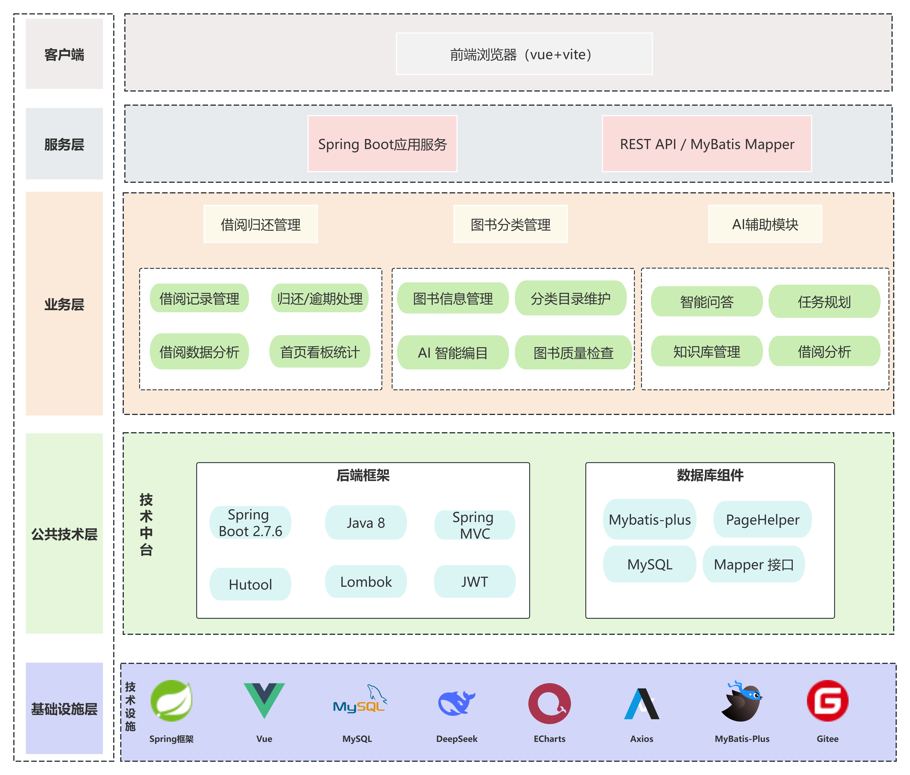
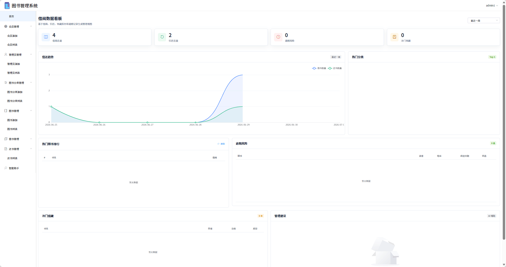
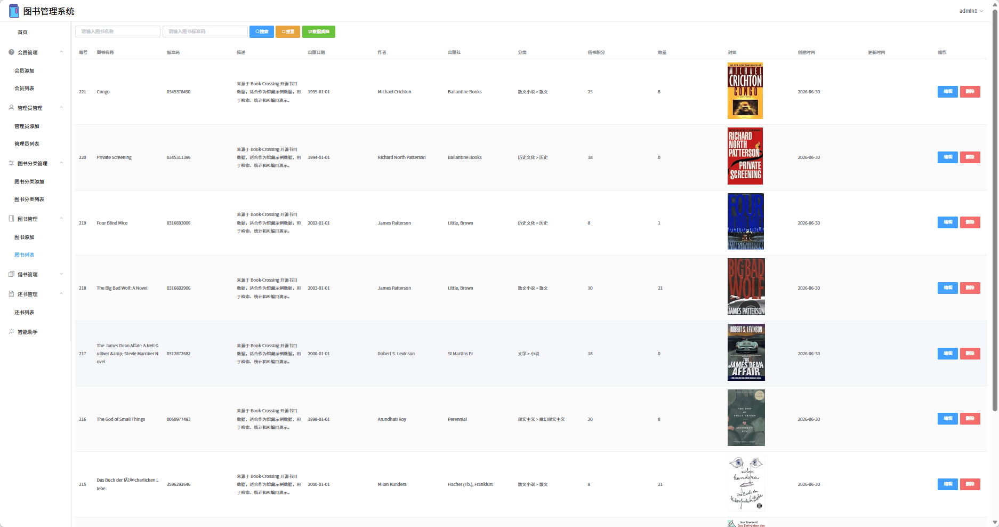
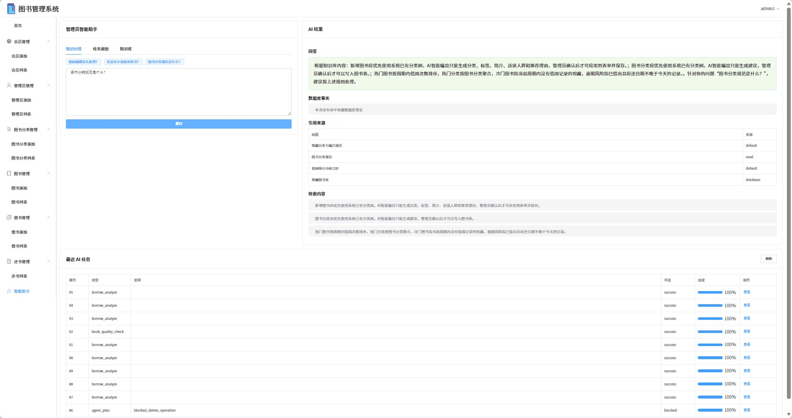
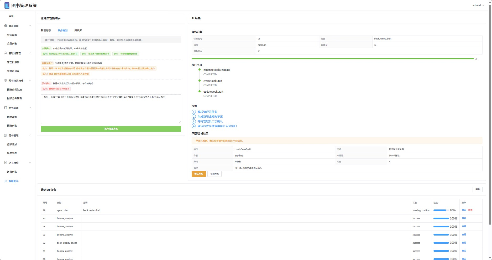
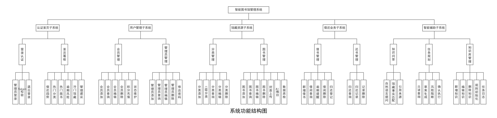

# 智能图书管理系统

面向图书馆日常管理的前后端分离项目，涵盖馆藏维护、会员管理、借阅归还和数据看板，并将知识问答、编目建议与任务规划接入管理流程。

管理员可以在同一套后台中完成图书入库、借还登记和库存查询，也可以用自然语言查询馆藏、了解借阅规则，或生成待确认的图书维护方案。新增、修改类任务先展示草案，再由管理员确认执行。

**Spring Boot 2.7 · Java 8 · Vue 2 · Element UI · MyBatis · MySQL · RAG · Agent**

[界面展示](#界面展示) · [主要功能](#主要功能) · [实现思路](#实现思路) · [本地运行](#本地运行) · [演示顺序](#演示顺序)



*架构示意图；当前代码使用 Vue CLI 和 MyBatis，具体版本见下方技术栈。*

## 界面展示

### 借阅数据看板

按时间范围查看借还趋势、热门分类、热门图书、逾期风险和冷门馆藏。



### 馆藏管理

集中维护书名、标准码、作者、出版社、分类、库存和封面，支持搜索、编辑和馆藏数据质检。



### 知识问答

回答与引用来源、检索内容一起展示，便于管理员核对借阅规则和馆藏信息。



### 任务规划

展示任务意图、风险等级、处理步骤和操作草案。涉及图书新增、修改时，可以确认或取消方案。



*以上为项目演示截图，图中的记录和统计值来自演示数据。*

## 主要功能

| 模块 | 功能 |
| --- | --- |
| 登录与账号 | 管理员登录、JWT 身份校验、账号状态维护、密码修改 |
| 会员管理 | 会员信息维护、分页查询、积分充值、启用与禁用 |
| 图书分类 | 分类树展示、一级及子分类维护、分类查询 |
| 馆藏管理 | 图书增删改查、封面上传、库存维护、编目建议、数据质检 |
| 借阅归还 | 借书登记、应还日期计算、过期提醒、还书登记、历史记录查询 |
| 数据看板 | 借还趋势、热门分类与图书、逾期风险、冷门馆藏、管理建议 |
| 知识问答 | 检索知识条目和馆藏事实，返回回答、引用来源及检索内容 |
| 任务规划 | 自然语言查询、图书新增与修改草案、确认执行、取消任务、任务记录 |
| 知识库 | 条目新增、编辑、删除，初始化借阅、分类和操作规则 |



## 实现思路

### 图书业务与智能辅助共用一套数据

前端通过 REST API 访问 Spring Boot 服务，后端以 Controller、Service、Mapper 分层组织代码。图书、分类、会员、借阅记录存放在 MySQL 中，智能模块按需读取这些业务数据。

```text
Vue 2 / Element UI / ECharts
             │ HTTP + JWT
             ▼
Spring Boot REST API
             │
     ┌───────┴────────────────┐
     │                        │
图书 / 会员 / 借还        智能辅助服务
     │                  ├─ 编目与质检
     │                  ├─ 知识检索与问答
     │                  └─ 任务规划与确认
     │                        │
     └───────┬────────────────┘
             ▼
      MyBatis / MySQL

智能辅助服务 ── AIClient ── 外部模型接口（可选）
```

借阅和归还操作通过事务处理库存、积分与业务记录的更新。智能模块确认后的图书写入复用原有业务 Service，避免另建一套写入逻辑。

### 先检索依据，再组织回答

知识问答先从知识库中按关键词检索相关规则并排序，同时查询匹配的馆藏事实，再将这些内容交给模型组织回答。接口会一并返回引用来源和检索内容，前端可以直接展示依据。

当前采用关键词检索与相关性排序，不需要部署向量数据库。找不到知识依据和馆藏事实时，系统返回“无法判断”；模型未配置或调用失败时，则根据已有检索内容组织本地回答。

### 按操作类型处理任务

任务规划通过关键词规则识别意图，将任务分为三类：

| 类型 | 示例 | 处理方式 |
| --- | --- | --- |
| 只读查询 | 筛选库存为 0 的图书、查看逾期情况 | 查询业务数据，返回结果与建议 |
| 新增或修改 | 新增一本图书、调整图书分类 | 生成待确认草案，确认后调用业务服务执行 |
| 删除类操作 | 删除、清空或移除数据 | 阻断自动执行，提示到业务页面人工处理 |

任务日志保存输入、结果和状态，便于查看待确认任务及历史处理记录。当前实现围绕图书管理中的固定任务展开。

### 模型服务按需接入

编目、质检摘要、借阅分析和知识问答通过统一的 `AIClient` 调用模型接口。未配置模型或请求失败时，相关功能使用本地规则、统计数据或检索内容回退处理；基础图书管理功能不依赖模型服务。

## 技术栈与目录

| 层次 | 技术 |
| --- | --- |
| 前端 | Vue 2.6、Vue Router 3、Element UI 2、Vue CLI 5 |
| 请求与图表 | Axios、ECharts 6 |
| 后端 | Java 8、Spring Boot 2.7.6、Spring MVC |
| 数据访问 | MyBatis、PageHelper、MySQL |
| 身份认证与工具 | JWT、Hutool、Lombok |
| 智能辅助 | 兼容 Chat Completions 格式的模型接口、知识检索、规则驱动的任务规划 |

```text
.
├── springboot/                 # 后端 Maven 工程
│   └── src/main/
│       ├── java/com/example/springboot/
│       │   ├── controller/     # 业务及智能辅助接口
│       │   ├── service/        # 业务服务、RAG、Agent、模型调用
│       │   ├── mapper/         # 数据访问接口
│       │   ├── entity/         # 数据实体
│       │   └── common/         # JWT 拦截、跨域、统一返回
│       └── resources/          # application.yml 与 Mapper XML
├── vue/                        # Vue 前端工程
│   └── src/
│       ├── views/              # 登录、看板、馆藏、借还、智能助手
│       ├── api/                # 智能辅助接口封装
│       ├── router/             # 页面路由
│       └── utils/              # 请求封装
├── sql/ai_tables.sql           # 智能模块增量建表及默认知识
└── docs/images/                # 项目展示图片
```

## 本地运行

### 1. 获取代码与准备环境

准备 JDK 8、Maven、Node.js/npm 和 MySQL。前端使用 Vue CLI 5，开发命令为 `npm run serve`。

```bash
git clone https://gitee.com/stdin2/smart-library-admin-ai.git
cd smart-library-admin-ai
```

### 2. 准备数据库

**当前仓库只包含智能模块的增量 SQL，尚未附带基础业务表的完整初始化脚本和初始管理员数据。首次部署需要先准备这两部分，不能仅导入 `ai_tables.sql` 就完成初始化。**

在已有业务数据库中执行 [sql/ai_tables.sql](sql/ai_tables.sql)，创建知识库、知识块、问答日志、任务日志等表，并写入默认知识条目。基础业务字段可对照后端的 [Mapper XML](springboot/src/main/resources/mapper) 和 [实体类](springboot/src/main/java/com/example/springboot/entity) 核对。

修改 [application.yml](springboot/src/main/resources/application.yml) 中的数据源配置：

```yaml
spring:
  datasource:
    driver-class-name: com.mysql.cj.jdbc.Driver
    url: jdbc:mysql://localhost:3307/library-management?serverTimezone=GMT%2b8
    username: your_database_user
    password: your_database_password
```

仓库默认数据库端口为 `3307`，请按本机实际端口修改。登录使用数据库中已初始化的管理员账号；密码存储格式需与 `AdminService` 的校验逻辑一致。

### 3. 启动后端

在 IDE 中将 `springboot/pom.xml` 导入为 Maven 工程，等待依赖加载完成，使用 JDK 8 运行 `com.example.springboot.SpringbootApplication`。

后端默认端口为 `9090`，接口统一前缀为 `/api`。当前 POM 中 Spring Boot 插件配置了 `skip=true`；如需通过插件启动或生成可执行 JAR，需先按部署方式调整该配置。

### 4. 启动前端

在项目根目录打开另一个终端：

```bash
cd vue
npm ci
npm run serve
```

访问终端输出的本地地址，通常为 `http://localhost:8080`。前端接口地址配置在 [vue/src/utils/request.js](vue/src/utils/request.js)，默认为 `http://localhost:9090/api`；后端地址变化时需同步调整。

前端生产构建命令为 `npm run build`，产物位于 `vue/dist/`。

### 5. 接入模型服务（可选）

在启动后端的终端中设置以下环境变量，再启动后端进程：

| 环境变量 | 含义 |
| --- | --- |
| `AI_API_URL` | 完整的 Chat Completions 请求地址，需包含接口路径 |
| `AI_API_KEY` | 服务提供方的 API Key |
| `AI_MODEL` | 对应服务支持的模型名称 |
| `AI_TIMEOUT` | 请求超时，单位毫秒，默认 `15000` |

接口需支持 `model`、`messages` 等请求字段，并通过 `choices[0].message.content` 返回文本。密钥放在本地环境变量中，不写入仓库。

## 演示顺序

准备少量分类、图书、会员和借还记录后，可以按下面的顺序展示：

1. **查看首页**：切换统计周期，介绍借还趋势和逾期风险。
2. **维护馆藏**：打开图书列表，查看分类、库存与封面，演示编目建议或数据质检。
3. **完成借还**：登记借阅，再执行归还，查看库存、积分和历史记录的变化。
4. **查询知识**：进入智能助手，提问“图书分类规范是什么？”，查看回答及引用来源。
5. **生成操作草案**：输入新增图书任务，核对草案后确认或取消，再查看任务记录。
6. **展示操作限制**：输入删除类任务，查看阻断提示。

其中，知识问答和任务确认适合与传统管理页面连贯演示：从查询依据到确认操作，能直观看到智能辅助如何参与日常图书管理。
